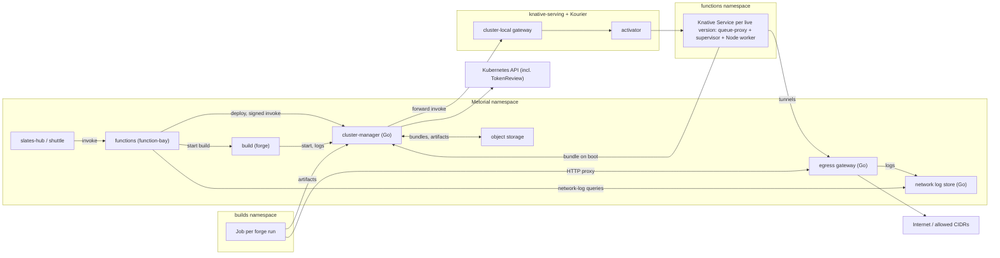

# Runtime system: Kubernetes-native functions and builds

Status: proposal, nothing implemented. This is the "Knative serving" follow-up named in
`ee/on-prem/HELM-PLAN.md` section 11. It covers the restructure of function-bay, forge and the
deflector into `oss/src/products/runtime`, a Kubernetes backend for functions (Knative Serving) and
builds (Jobs), and a new per-request egress system that replaces the deflector and observer for both
Lambda and Kubernetes. Decisions taken in review are listed in section 3.

## 1. Goals

- Run functions and builds in any Kubernetes cluster, so on-prem installs no longer need AWS Lambda,
  AWS CodeBuild or a Docker daemon.
- Fast, reliable, easy to operate: Knative does scaling and request routing, Kubernetes is the source
  of truth for what is running, and our own code stays small.
- Isolation per function and per build: standard containers (runc) or gVisor, selected through a
  RuntimeClass. Kata or others later without code changes.
- A concurrency setting per function: `exclusive` (one request per instance, like Lambda) or `shared`
  (one instance serves several requests at once).
- Egress rules enforced per request, including in `shared` mode, with network logs.
- Encryption in transit delegated to Knative (Kourier) or to the mesh (Istio).
- Support every current function (all slates, all custom providers) and future compatible ones.
- Local development against a local cluster, set up by `control`; fall back to today's `local`
  providers when there is none.
- Well tested: shared provider conformance suites, egress and security suites, a scale test.

Non-goals for v1:

- A Python runtime and builder. The core is language-neutral so both can be added later (section 8.7).
- Building container images inside builds.
- Full Lambda or CodeBuild API compatibility. We implement what function-bay and forge need.
- Moving the cloud deployment off Lambda and CodeBuild. The cloud only switches its egress system.

## 2. What exists today

| Piece | Today | Problem |
|---|---|---|
| function-bay providers | `aws.lambda`, `local` | `local` runs function code as a child process of the function-bay service. On-prem runs it in production. |
| forge adapters | `aws.code-build`, `local` | `local` shells out to the `docker` CLI and pulls `oven/bun:1`; it doesn't work inside Kubernetes. |
| Function builds | A forge workflow that runs `curl bun.sh` and `bunx function-bay@latest` | Needs the internet at build time; fails on air-gapped installs. |
| Bundle wrappers | Build time: `@function-bay/nodejs` compiles a launcher (`metorial_launcher.js`: handler resolution, payload parsing, response envelope) into the same `index.js` as the user code. Deploy time: the Lambda provider adds `metorial_deflector_wrapper.cjs` with bundled proxy agents. | Both are baked into every bundle. The `local` provider reuses the Lambda layer, so on-prem bundles contain the launcher too. |
| Egress | Deflector (Go HTTP proxy, HS256 JWT per invocation) + observer (network logs) | Node-only, opt-in, process-wide state, connection pools cross requests, raw TCP bypasses it. Not deployed on-prem at all. |
| Slate isolation | slates-hub sets `disableNetworkIsolation` unless the slate manifest sets `networkIsolation: true` | Most slates run without egress rules. |
| Internal destinations | The deflector blocks private and metadata ranges only when a grant has no policy. Any policy entry that covers them opens them, and an enclave without firewalls compiles to `0.0.0.0/0` and `::/0` (`unrestrictedNetworkAllowList`). | In the cloud, enclave invocations can reach private and metadata addresses from the deflector's network today. On-prem has no way to allow internal systems on purpose. |
| Artifacts | Signed object-store URLs given to CodeBuild | The object store's `local` backend returns unsigned URLs. |

Call sites that must keep working unchanged:

- slates-hub `deploy.ts` and `stack.ts`: create a function per slate version, invoke with
  `{ messages, invocationId }`, per-invocation tenant, enclave and egress policy.
- shuttle `startDeployment.ts` and `call.ts`: custom providers, one function per tenant.
- enclave module: network logs via function-bay's `networkLogService` (observer `/logs` query API).

## 3. Decisions

1. Functions run on Knative Serving. Builds run as plain Kubernetes Jobs.
2. One Go service, `cluster-manager`, owns every Kubernetes interaction. function-bay and forge get
   thin adapters and need no cluster permissions.
3. One Knative Service per function version. Nothing is materialized by default: versions are created
   on demand or speculatively, and garbage-collected when idle, including the latest version of a
   function.
4. The cluster-manager has no database. Kubernetes objects are its state, object storage holds
   bundles, and function-bay and forge stay the sources of truth. Wiping the runtime namespaces is
   safe (section 6.4).
5. Callers authenticate with Kubernetes ServiceAccount tokens: audience-bound, short-lived, rotated
   by the kubelet, verified by the cluster-manager through the TokenReview API. On Kubernetes there
   are no shared secrets between services, and no per-build or per-version credentials
   (section 6.3).
6. Every invocation carries a token signed by function-bay. The function pod's supervisor verifies it
   with public keys mounted from a ConfigMap, so only function-bay can invoke a function, even from
   inside the cluster (section 7.7).
7. Concurrency modes: `exclusive` and `shared`. Slates default to `shared`. Custom providers are
   hard-coded to `exclusive` for now.
8. Sandbox per function and build through RuntimeClass: `runc` or `gvisor`.
9. Knative bundles contain only build output. Handler loading, the response envelope and egress
   interception live in the function image, so no wrapper code is added to bundles (section 7.6).
10. A new egress gateway with per-request grants replaces the deflector and observer for Lambda,
    Knative and builds.
11. Grants are new-format only (EdDSA JWTs). No HS256 compatibility: function-bay switches the proxy
    URL and the token in the same release, so each invocation uses one consistent pair.
12. Existing Lambdas can't be redeployed. The gateway keeps the deflector's wire behaviour for them,
    proven by differential tests against every historical wrapper version.
13. `disableNetworkIsolation` stays supported in function-bay. In the on-prem edition, slates-hub
    never sets it, so every slate gets egress rules. The cloud edition keeps today's behaviour.
14. Internal destinations are opt-in through the normal egress rules (network policies in firewalls).
    On-prem, a rule that names an internal range opens it. In the cloud, internal ranges are never
    reachable, whatever the rules say. Broad rules (`0.0.0.0/0`, `allowAll`) mean the public
    internet in both editions. Loopback, link-local, metadata endpoints and the cluster's own ranges
    are never reachable in either edition (section 8.2).
15. Builds never talk to the object store. Artifacts go through the cluster-manager.
16. Encryption: two modes, Kourier with Knative's TLS features, or Istio mutual TLS.
17. The Helm chart can optionally install Knative; customers can also bring their own.
18. Restructure into `oss/src/products/runtime` first, as a pure move. Package, component and env-var
    renames are a separate follow-up.
19. Python is out of scope for v1.
20. New services are Go (cluster-manager, supervisor, gateway, log store). function-bay and forge stay
    TypeScript.
21. Every request/response interface between our services uses lowerdeck RPC: `ldrpc` in Go,
    `@lowerdeck/rpc-client` in TypeScript. Interfaces are defined once as `@lowerdeck/rpc-spec`
    specs, which generate the Go server and client and the TypeScript client. Byte streams
    (bundles, artifacts) and the egress data plane stay plain HTTP (section 5.2).

## 4. Repository layout

Every service directory has a `service/` and, where needed, a `packages/` directory for packages
that belong to that service only. `packages/` at the top level is for code shared across services.

```
oss/src/products/runtime/
  go.mod                        # one Go module for all Go code in the system
  services/
    build/                      # forge
      service/                  #   TS service: workflows, runs, artifacts
        src/providers/          #     local, aws-codebuild, kubernetes (new)
    functions/                  # function-bay
      service/                  #   TS service: functions, versions, invoke, token minting
        src/providers/          #     local, aws-lambda, knative (new)
      packages/
        cli/                    #   npm `function-bay` (name unchanged)
        builder-node/           #   npm `@function-bay/nodejs`
        types/                  #   npm `@function-bay/types`
        utils/                  #   npm `@function-bay/utils`
        runtime-node/           #   Node bootstrap that runs inside function pods (new)
    networking/                 # replaces deflector + observer
      spec/                     #   rpc-spec: network-logs (log store ingest and query)
      service/                  #   Go: cmd/gateway, cmd/logstore, internal/...
        rpc/networklogsrpc/     #     generated
    cluster-manager/
      spec/                     #   rpc-spec: cluster-manager (control API), function-runtime (supervisor)
      service/                  #   Go: cmd/cluster-manager, internal/{api,functions,builds,bundles,gc,preflight,kube}/
        rpc/clustermanagerrpc/  #     generated
        rpc/functionruntimerpc/ #     generated, also used by the supervisor
      supervisor/               #   Go: in-pod supervisor, built into function images
      images/
        function-node24/
        build-ubuntu/
      deploy/knative/           #   pinned Knative + Kourier manifests for local dev and CI
  clients/
    build/                      # @metorial-platform-systems/forge-client (name unchanged)
    functions/                  # @metorial-platform-systems/function-bay-client (name unchanged)
    networking/                 # TS client for the network-log query API (generated from the spec)
    cluster-manager/            # TS client for the cluster-manager control API (generated from the spec)
  packages/
    egress/                     # Go: grant and invocation-token formats, policy evaluation, JSON test vectors
  package.json                  # `go test ./...` and `rpc-spec generate --check`, so Turbo runs Go CI
```

The Go module points at `oss/src/lowerdeck/go/ldrpc` with a `replace` directive. Generated files
are committed, so Go builds don't need Bun. CI runs `rpc-spec generate --check` and fails when a
generated file is out of date. Spec packages are private TS packages with a `generate` script, as in
the ldrpc plan (`oss/src/lowerdeck/docs/rpc/go-services-plan.md`).

Move map for M0:

| From | To |
|---|---|
| `oss/src/forge/service` | `services/build/service` |
| `oss/src/forge/clients/forge` | `clients/build` |
| `oss/src/function-bay/service` | `services/functions/service` |
| `oss/src/function-bay/clients/function-bay` | `clients/functions` |
| `oss/src/function-bay/packages/{function-bay,nodejs,types,utils,tsconfig}` | `services/functions/packages/{cli,builder-node,types,utils,tsconfig}` |
| `oss/src/function-bay/scripts` | `services/functions/service/scripts` |
| `oss/src/function-bay/deflector` | `services/networking/legacy/deflector` (separate Go module, kept until the M1 cutover) |
| `oss/src/function-bay/observer` | removed; the log store replaces it in place |
| `oss/src/forge/.gitignore`, `oss/src/function-bay/{.gitignore,.dockerignore}` | `services/build/.gitignore`, `services/functions/{.gitignore,.dockerignore}` |

M0 touches only paths:

- `oss/package.json` workspaces gain explicit globs: `src/products/*/services/*/service`,
  `src/products/*/services/*/spec`, `src/products/*/services/*/packages/*`, `src/products/*/clients/*`,
  `src/products/*/packages/*`, `src/products/*`.
- `oss/src/tooling` references, control manifests (`control/index.ts` in each service, `ciImage`
  Dockerfile paths), and one deploy script.

`ee/on-prem/services/{forge,function-bay}` import by package name and are unaffected. The npm names,
client package names, deployed component names (`forge`, `function-bay`), image names and env vars
such as `FORGE_API_URL` stay as they are.

New TypeScript code follows the existing structure: the `knative` provider is a `ProviderImpl` next to
`aws-lambda`; the `kubernetes` build adapter extends `ForgeBuildAdapter` next to `aws-codebuild`;
business logic uses `Service.create()` services.

## 5. Architecture



| Component | Language | Runs as | Responsibility |
|---|---|---|---|
| functions | TS | existing `function-bay` component | Function/version model, provider selection, minting of grants and invocation tokens, `knative` provider |
| build | TS | existing `forge` component | Workflow/run model, `kubernetes` adapter, build grant minting |
| cluster-manager | Go | new Deployment, 2+ replicas, leader election for GC | Knative Services, Jobs, Secrets; caller authentication; invoke forwarding; bundle repack and relay; artifact relay; build logs; GC; preflight |
| supervisor | Go | entrypoint of function images | Bundle fetch and unpack, invocation-token verification, worker lifecycle, request dispatch, per-request logs, egress tunnels |
| Node bootstrap | TS | inside the worker process | Handler loading, response envelope, async-context propagation, socket and DNS interception, per-request pools |
| egress gateway | Go | new Deployment, autoscaled | Grant verification, DNS resolution, policy checks, tunnelling, observations |
| log store | Go | new Deployment | Stores observations; `network-logs` RPC service for ingest and queries; the observer's `/logs` API until function-bay has switched |

### 5.1 Flows

Deploy a function version (knative provider):

1. function-bay creates the deployment and forge build as today. The knative runtime uses a workflow
   variant without the Bun install step, because the build image has the CLI pre-installed. The
   builder compiles the user entrypoint directly, with no launcher (section 7.6).
2. On build success, the provider calls `bundle:import` with the build artifact's bucket and key.
   The cluster-manager reads the zip from object storage, repacks it as `tar.zst` and stores it in
   the bundle bucket.
3. The provider writes `providerData` (bundle ref, entrypoint, runtime, configuration, env encrypted
   with function-bay's existing encryption).
4. It calls `function:ensure` with `mode: speculative`. The cluster-manager materializes the version
   only if a sibling version was used recently (section 7.2).

Invoke:

1. function-bay mints an egress grant and an invocation token, then calls `function:invoke` with the
   payload as a JSON string, retries disabled.
2. If the version is materialized, the cluster-manager calls `invoke` on the pod's supervisor through
   the Knative Service, passing the same fields through. Knative scales from zero if needed.
3. If not, the cluster-manager answers `function_not_materialized`. The provider decrypts the env,
   calls `function:ensure` with `mode: on-demand` (which waits until Ready), mints fresh tokens and
   retries once.
4. The supervisor verifies the invocation token before the worker sees anything (section 7.7).
5. The response carries `{ statusCode, body }` plus logs and timings, so `parseInvocationPayload`
   works unchanged.

Build:

1. forge's `kubernetes` adapter renders the run as one script (shared generator, section 9.1), mints a
   build grant and calls `build:start`.
2. The cluster-manager creates a Secret (script, env, artifact spec) and a Job.
3. The build pod authenticates to the cluster-manager with its own pod-bound token to fetch inputs and
   upload outputs (section 6.3).
4. The adapter polls status and logs, parses step markers, writes them through `BuildContext`, and
   completes the run with the uploaded artifacts.
5. It then calls `build:delete`.

### 5.2 Service interfaces

| Interface | Server | Callers | Transport | Spec |
|---|---|---|---|---|
| Cluster-manager control API | cluster-manager, control listener | function-bay, forge | lowerdeck RPC | `cluster-manager` |
| Function runtime | supervisor, behind queue-proxy | cluster-manager | lowerdeck RPC | `function-runtime` |
| Network logs | log store | gateway (ingest), function-bay (queries) | lowerdeck RPC | `network-logs` |
| Pod-facing bundle and artifact endpoints | cluster-manager, pod-facing listener | supervisors, build scripts (`curl`) | plain HTTP streams | none |
| Egress | gateway | supervisors, Lambda wrappers, build tools | HTTP/2 and HTTP/1.1 `CONNECT`, proxy forwarding | none |
| Supervisor ↔ worker | supervisor | Node worker | unix socket frames (section 7.6) | documented in `runtime-node` |

Lowerdeck RPC is used wherever the shape is "typed request, typed response":

- One spec per interface, written in the `@lowerdeck/rpc-spec` DSL. It generates the Go `Service`
  interface, `Register()`, error constructors and Go client, plus the TypeScript client type.
  function-bay and forge get generated clients with exact types and documented error codes, and
  don't have to hand-write or infer them.
- Input validation comes from the spec through `ldrpc.WithInputSchema`, with the same `invalid_data`
  issues a TypeScript service would return.
- One error model (`@lowerdeck/error` shape) across TS and Go, and the same retry and deadline
  behaviour in both clients.

It isn't used for:

- **Byte streams.** The protocol has no streaming, buffers whole bodies, and caps Go request bodies
  at 32 MiB. Bundles (up to hundreds of MB) and build artifacts go over plain HTTP on the pod-facing
  listener, streamed end to end. Build scripts call them with `curl`, which couldn't speak the
  envelope anyway.
- **The egress data plane**, which is raw TCP tunnels, and the Lambda-facing proxy, whose wire
  format is fixed by deployed wrappers.

Rules for using it here:

- **Retries.** Both clients retry 5xx and transport failures, so a call may run more than once.
  `function:invoke` (TS client) and `invoke` (Go client) run user code, so they're declared
  non-idempotent in the spec, and the generated clients never retry them (section 5.3). The
  supervisor's replay cache is the second line of defence. Every other method is idempotent by
  design: ensure and delete by deterministic name, `build:start` by run ID, `bundle:import` by
  version ID.
- **Deadlines.** The default client deadline is 2 minutes. `function:invoke`, `invoke` and on-demand
  `function:ensure` pass an explicit per-call timeout: the function timeout plus the boot allowance.
- **Payload bytes.** Invocation payloads travel as a JSON string (`payloadJson: t.string()`), not as a
  nested JSON value. The invocation token signs the hash of those exact bytes, and serialize-envelope
  encoding would otherwise be free to change them on the way. The spec's `maxLength` counts
  characters, so both servers also check the UTF-8 byte length against `MAX_PAYLOAD_BYTES` and
  answer `invalid_data` when it's exceeded.
- **Body limits.** The supervisor's and cluster-manager's `MaxBodyBytes` are set from the largest
  allowed payload plus the 1 MB log cap, not left at the 32 MiB default.
- **Authentication** uses the `Authenticate` hook with ServiceAccount tokens on Kubernetes
  (section 6.3). The log store also runs in the cloud, on ECS with no ServiceAccounts. There it uses
  ldrpc's built-in HMAC signing with a secret from settings.

### 5.3 Changes to ldrpc and rpc-spec

ldrpc and rpc-spec are new, and this system is their first real user. Improvements needed on the
way, each landing in `oss/src/lowerdeck` with its own tests:

| Change | Why | Milestone |
|---|---|---|
| Go generator (rpc-spec phase 2): types, `Service`, `Register`, error constructors, `Client`, input schemas, with golden tests | Today `generate/go.ts` is a stub, and every spec here needs it | M1 |
| `ldrpc/otel` subpackage (planned in rpc-spec phase 4): `otelhttp` around `Server`, trace headers from the client, structured logs from `OnCall`/`OnError` | Tracing across function-bay → cluster-manager → supervisor | M1 |
| Spec flag `.idempotent(false)` on `method()`, carried in the IR. Generated TS clients pass `retry: false`; generated Go clients apply `WithoutRetry()` | Invocations must never be retried by the transport. Today that relies on every call site remembering it | M2 |
| `ldrpc/kubeauth` subpackage: `Authenticate` for ServiceAccount bearer tokens via TokenReview, with audience check and cache. It exposes `Identity{Namespace, ServiceAccount, PodName, PodUID}` through `CallInfo.Auth`. Uses only the standard library and the in-cluster credentials | Shared by the cluster-manager and any later in-cluster Go service | M2 |
| `@lowerdeck/rpc-client` helper `projectedTokenHeaders(path)` for `getHeaders`: reads the token file, caches it by modification time, re-reads on 401 | function-bay and forge authenticate to Kubernetes-hosted Go services | M2 |

Gaps found while implementing go back into the ldrpc plan rather than being worked around locally.
For example, if Knative's queue-proxy turns out to rewrite anything covered by signatures, that goes
into the protocol notes.

## 6. Cluster-manager

### 6.1 API

Two listeners, so NetworkPolicy can allow runtime pods only the pod-facing one. Ports are proposals.

| Listener | Port | Callers | Interface |
|---|---|---|---|
| Control | 52240 | functions, build | lowerdeck RPC at `/rpc`, spec `cluster-manager` |
| Pod-facing | 52241 | function pods, build pods | Plain HTTP streams: `GET /v1/bundles/self` (the calling pod's bundle), `GET /v1/builds/self/artifacts/{artifactId}`, `PUT /v1/builds/self/uploads/{stepId}` |

Pod-facing endpoints take no version or build ID. The cluster-manager derives them from the caller's
identity, so a pod can't ask for anything but its own.

Control methods (`services/cluster-manager/spec`, Go package `clustermanagerrpc`, TS client
`ClusterManagerClient`):

| Method | Caller | Idempotent | Purpose |
|---|---|---|---|
| `bundle:import` | functions | yes, by version ID | Read a build zip from object storage by `{ bucket, key }`, repack as `tar.zst`, store it; returns `{ bucket, key, sha256, sizeBytes }` |
| `function:ensure` | functions | yes, by name | Materialize a version; `mode: on-demand` waits until Ready, `speculative` may decline |
| `function:delete` | functions | yes | Delete a version's Knative objects |
| `function:list` | functions | yes | Materialized versions of a function, with state and last use |
| `function:invoke` | functions | **no**, never retried | Forward one invocation (section 7.8) |
| `build:start` | build | yes, by run ID | Create the Secret and Job (section 9.2) |
| `build:get` | build | yes | Job status, exit code, uploaded steps |
| `build:logs` | build | yes | Log lines after a cursor |
| `build:delete` | build | yes | Delete the Job and its Secret |

Declared errors include `function_not_materialized` (404), `function_not_ready` (503, ensure timed
out), `function_unavailable` (503, no ready pod before the invoke deadline), `bundle_invalid` (422:
bad archive, size or checksum), `build_not_found` (404) and
`cluster_capacity` (503, the `maxMaterialized` cap can't evict anything). They become Go constructors
and typed codes on the TS client.

The cluster-manager never fetches URLs on a caller's behalf. Every object reference is a
`{ bucket, key }` pair checked against a per-identity bucket allowlist from configuration:

| Identity | May read | May write |
|---|---|---|
| functions service | forge's artifact bucket and the bundle bucket (`bundle:import`, including re-homed `local` bundles), the bundle bucket (`function:ensure`) | the bundle bucket, only through `bundle:import` |
| build service | forge's artifact bucket (`downloads`) | forge's artifact bucket (`uploads`) |

A compromised forge therefore can't point build uploads at the bundle bucket, and a compromised
function-bay can't use the cluster-manager to read arbitrary buckets.

Function env names are checked too. `function:ensure` rejects reserved names with `invalid_data`:
`NODE_OPTIONS`, `NODE_PATH`, `NODE_EXTRA_CA_CERTS`, `LD_*`, `METORIAL_*`, `CLUSTER_MANAGER_*` and
`EGRESS_GATEWAY_*`. Lambda reserves `AWS_*` the same way. Without this, a custom provider could load
code before the bootstrap's interception or override the addresses the supervisor uses.

`function:ensure` input, as declared in the spec:

```ts
ensure: method({
  input: t.object({
    versionId: t.string(), functionId: t.string(), tenantId: t.string(),
    mode: t.enum(['on-demand', 'speculative']),
    runtime: t.object({ identifier: t.literal('nodejs'), version: t.string() }),
    entrypoint: t.object({ path: t.string(), export: t.string(), kind: t.enum(['module', 'enveloped']) }),
    bundle: BundleRef,
    env: t.record(t.string()),
    memoryMb: t.int({ min: 128, max: 10240 }), timeoutSeconds: t.int({ min: 1, max: 900 }),
    concurrency: t.enum(['exclusive', 'shared']), sandbox: t.enum(['runc', 'gvisor']).optional()
  }),
  output: t.object({ state: t.enum(['materialized', 'declined']), name: t.string().optional() }),
  errors: [functionNotReady, clusterCapacity]
})
```

### 6.2 Identities

| Identity | ServiceAccount | Token audience | May call |
|---|---|---|---|
| functions service | `metorial-functions` in the platform namespace | `metorial-cluster-manager` | Control: bundles, functions, invoke |
| build service | `metorial-build` in the platform namespace | `metorial-cluster-manager` | Control: builds |
| function pod | `function-runtime` in the functions namespace | `metorial-cluster-manager-pods` | Pod-facing: its own version's bundle |
| build pod | `build-runtime` in the builds namespace | `metorial-cluster-manager-pods` | Pod-facing: its own build's declared artifacts and uploads, while the Job runs |

Control and pod-facing tokens use different audiences, so a pod token is rejected by the control
listener even before the ServiceAccount allowlist is checked. Neither audience is the API server's, so
none of these tokens can be used against the Kubernetes API. All four ServiceAccounts set
`automountServiceAccountToken: false`. The only token in each pod is the explicitly projected one.

The log store uses the same scheme with its own audience (section 8.1):

| Identity | ServiceAccount | Token audience | May call |
|---|---|---|---|
| egress gateway | `metorial-egress-gateway` in the platform namespace | `metorial-network-logs` | `observation:ingestMany` |
| functions service | `metorial-functions` (second projected token) | `metorial-network-logs` | `observation:list` |

The log store runs as `metorial-network-logs` with its own `system:auth-delegator` binding. The
gateway's and log store's ServiceAccounts also set `automountServiceAccountToken: false`.

### 6.3 Authentication

Every caller sends `Authorization: Bearer <projected ServiceAccount token>`:

- **Token source.** Each caller pod mounts a projected `serviceAccountToken` volume with the audience
  from the table above and `expirationSeconds: 3600`. The kubelet rotates the file at 80 % of its
  lifetime, so clients re-read it on every request. On the TS side that's `projectedTokenHeaders`
  passed as the RPC client's `getHeaders` (section 5.3). Knative Services allow projected
  `serviceAccountToken` volumes, so function pods work the same way as Jobs.
- **Verification** is `ldrpc/kubeauth`: the control listener's `Authenticate` hook, and the same
  verifier as plain HTTP middleware on the pod-facing listener. It calls the TokenReview API with
  the expected audience. The
  result gives the ServiceAccount (`system:serviceaccount:<ns>:<name>`) and, for pod-bound tokens,
  the pod name and UID. TokenReview rejects a bound token as soon as its pod is deleted. This needs
  a ClusterRoleBinding to `system:auth-delegator`, which grants only `tokenreviews` and
  `subjectaccessreviews` creation.
- **Caching.** Successful reviews are cached by token hash for the shorter of 60 seconds and the
  token's remaining lifetime. That's about one TokenReview per caller pod per minute, independent of
  invocation rate.
- **Authorization.** Control callers are matched against the ServiceAccount allowlist. For
  pod-facing callers, the cluster-manager looks the pod up in its informer cache:
  - function pods: the pod's `runtime.metorial.com/version-id` label selects the bundle;
  - build pods: the owning Job's `runtime.metorial.com/build-id` label selects the build. The Job
    must not have finished, and the artifact or step ID must be in the build's spec. The spec lives
    in the Job's Secret under a key that isn't mounted into the pod.
- **Istio mode** adds an AuthorizationPolicy on the control port that allows only the two platform
  ServiceAccount principals. Tokens are still required, so both modes behave the same.

Why ServiceAccount tokens rather than alternatives:

- A shared secret from settings has to be distributed and rotated, and a leaked copy works
  everywhere, forever. Projected tokens expire within an hour, are bound to one audience and one pod,
  and need no secret management.
- Per-build HMAC tokens would need a cluster-manager key, Secret plumbing into every Job, and an
  expiry scheme. Pod-bound tokens give the same scoping for free, and they die with the pod.
- Verifying tokens offline against the cluster's issuer JWKS would avoid the TokenReview call, but
  it loses revocation on pod deletion and issuer discovery differs across distributions. With the
  cache, TokenReview load is negligible.

Edge cases:

- **Separate functions cluster** (section 7.4): the cluster-manager runs in the platform cluster.
  Control tokens are reviewed in-cluster. Pod tokens are issued by the functions cluster, so they're
  reviewed there, through the cluster-manager's kubeconfig for that cluster.
- **Local development**: function-bay and forge run on the host. `control` creates the two platform
  ServiceAccounts in the local cluster, mints tokens with the TokenRequest API (the equivalent of
  `kubectl create token metorial-functions --audience metorial-cluster-manager --duration 24h`),
  writes them to files, and points `CLUSTER_MANAGER_TOKEN_FILE` at them. The client re-reads the file
  on a 401.

### 6.4 State

The cluster-manager has no database of its own, and adds no Postgres or Redis dependency:

| State | Where it lives |
|---|---|
| Version specs, env, configuration | function-bay's database (`providerData`); sent on every `function:ensure` |
| What is materialized | Knative Services in the functions namespace, labelled by function, version and tenant |
| Last use, materialization reason | Annotations on the Knative Service, flushed at most every 5 minutes |
| Function env | A Secret per Knative Service, owned by it |
| Running builds and their artifact spec | Jobs and their owned Secrets in the builds namespace |
| Build logs | Pod logs from the kubelet, until forge has drained them |
| Bundles | Object storage (the existing bundle bucket), plus an optional size-capped disk cache per replica |
| GC leadership | A `coordination.k8s.io` Lease |
| Hot read path | Informer caches of Knative Services, pods and Jobs, in memory |

This keeps the cluster-manager stateless and horizontally scalable, with no migrations. If the runtime
namespaces are wiped, every version re-materializes on its next invocation. Limits: annotation writes
are rate-limited by design, and kubelet log rotation caps build logs (section 16).

## 7. Functions

### 7.1 Changes in function-bay

- `DEFAULT_PROVIDER` gains `knative`. A `knative` provider row is upserted at boot like
  `aws-lambda/provider.ts`.
- `FunctionBayLayer.provider` in `@function-bay/types` gains `knative`.
- `FunctionConfiguration` (typed JSON, no schema migration) gains:
  - `concurrency: 'exclusive' | 'shared'`, default `exclusive`. slates-hub sets `shared`; shuttle
    never sets it.
  - `sandbox?: 'runc' | 'gvisor'`; empty means the installation default.
  - `egress?: CompiledEgressNetworkAllowList`, static per-function rules that are intersected with the
    per-invocation policy.
- `disableNetworkIsolation` keeps working for every provider. On knative it maps to an `allowAll`
  grant: traffic still goes through the gateway, is still logged, and the hard deny list still
  applies (section 8.2).
- `providerData` for knative versions: `{ bundle: { bucket, key, sha256, sizeBytes }, entrypoint:
  { path, export, kind }, runtimeIdentifier, encryptedEnvironmentVariables }`. `kind` is `module` for
  new builds and `enveloped` for re-homed bundles that still contain the Lambda launcher (section 7.6).
- `cloneFunctionVersion` reuses the source bundle and re-encrypts the env for the new version.
- Creating a knative version with a reserved env name (section 6.1) fails with a validation error,
  so users see the problem at deploy time rather than as a failed `function:ensure`.
- Token minting replaces `createDeflectorToken` and `createLegacyDeflectorToken`: an egress grant
  (section 8.2) and an invocation token (section 7.7) per invocation.
- A re-home job converts existing `local` versions on on-prem installs to `knative` (section 12.3).

Changes in slates-hub (`queues/deployment/config.ts`):

```ts
disableNetworkIsolation: !checkEdition('on-prem') && d.manifest.networkIsolation !== true
```

On-prem, every slate then runs with egress rules: the enclave's compiled policy, or public internet
only when there is none. Customers allow internal systems, such as a self-hosted GitLab, with a
network policy that names the internal range (section 8.2). The cloud is unchanged.
`config.test.ts` gains on-prem cases.

### 7.2 Materialization and GC

States: **cold** (bundle and spec only, the vast majority), **materialized** (Knative objects, zero
pods), **warm** (pods running).

- **Names.** `fn-<20 chars of base32(sha256(versionId))>`, deterministic and well within Kubernetes
  name limits. Labels on the Knative Service and its pod template:
  `runtime.metorial.com/{function-id,version-id,tenant-id}`. Annotations:
  `runtime.metorial.com/{last-invoked-at,materialized-reason}`.
- **On demand.** Create with `initial-scale: 1` and wait for Ready. Creation is idempotent by name, so
  concurrent creators across replicas just wait. No lock is needed.
- **Speculative.** List sibling versions by function label. If one was invoked within
  `speculativeWindow` (default 24 h), create the new version with `initial-scale` equal to that
  sibling's ready pod count, capped. With zero, Knative's `allow-zero-initial-scale` makes it Ready
  without a pod.
- **Last use.** Each replica records invocations in memory and patches `last-invoked-at` at most every
  5 minutes per version, with jitter.
- **GC** runs on the leader replica every minute:
  - Speculative, never invoked: TTL `speculativeTtl` (default 1 h).
  - Invoked, now idle: TTL `idleTtl` (default 6 h). Idle versions still cost two ClusterIP Services
    each, so this TTL is short on purpose.
  - Hard cap `maxMaterialized`: before creating a version past the cap, evict the least recently used
    one, preferring versions with no pods.
  - Deleting the Knative Service deletes its env Secret through the owner reference.
- **Explicit delete.** `function:delete` when function-bay deletes a version.

Default cap starting points, to be validated by the scale test (section 14): about 1,000 with
kube-proxy in iptables mode, about 2,500 with nftables mode or Cilium's kube-proxy replacement.

### 7.3 Why the cap matters

Each live version brings two ClusterIP Services (the revision's public and private Services) and one
ExternalName Service (no kube-proxy rules). kube-proxy programs every ClusterIP on every node, even
though Knative routes to endpoint IPs directly, and re-syncs on every endpoint change. Scale-to-zero
changes endpoints constantly.

### 7.4 Scale levers

Strongest first:

1. The cap and TTLs above.
2. Less endpoint churn: `scale-down-delay` and `scale-to-zero-pod-retention-period` so pods don't
   flap; minimum scale for the hottest functions.
3. A data plane that scales: nftables kube-proxy (GA since 1.33; upstream recommends 1.36+ with a
   recent kernel at scale) or Cilium. kube-proxy's IPVS mode is deprecated since 1.35 and must not be
   recommended. Preflight warns when the cap doesn't fit the configured mode.
4. A separate functions cluster: the cluster-manager reaches Kubernetes through a kubeconfig and
   invokes through a configurable gateway URL, so large installs can move functions off the platform
   cluster.
5. Later, only if needed: several slate versions per Knative Service.

### 7.5 Knative Service template

```yaml
apiVersion: serving.knative.dev/v1
kind: Service
metadata:
  name: fn-<hash>
  namespace: metorial-runtime-functions
  labels:
    networking.knative.dev/visibility: cluster-local
    runtime.metorial.com/function-id: <id>
    runtime.metorial.com/version-id: <id>
spec:
  template:
    metadata:
      labels:
        runtime.metorial.com/function-id: <id>
        runtime.metorial.com/version-id: <id>   # pod identity for the bundle endpoint
      annotations:
        autoscaling.knative.dev/min-scale: "0"
        autoscaling.knative.dev/max-scale: "<config>"
        autoscaling.knative.dev/initial-scale: "<1 | mirrored | 0>"
        autoscaling.knative.dev/scale-down-delay: "<config>"
        autoscaling.knative.dev/target-utilization-percentage: "70"
    spec:
      containerConcurrency: <1 | sharedConcurrency>
      timeoutSeconds: <timeoutSeconds + boot allowance>
      runtimeClassName: <runc | gvisor>
      serviceAccountName: function-runtime        # no RBAC bindings, automount disabled on the SA
      enableServiceLinks: false
      containers:
        - image: <function-node24@sha256:...>
          envFrom: [{ secretRef: { name: fn-<hash>-env } }]
          env: [METORIAL_FUNCTION_ID, METORIAL_FUNCTION_VERSION_ID, METORIAL_EXECUTION_ENV,
                METORIAL_RUNTIME, METORIAL_ENTRYPOINT, CLUSTER_MANAGER_POD_ADDR,
                EGRESS_GATEWAY_ADDR, ...]
          resources:
            requests: { cpu: <proportional to memory>, memory: <memoryMb> }
            limits: { memory: <memoryMb>, ephemeral-storage: <config> }
          securityContext:
            runAsNonRoot: true
            runAsUser: 65532
            seccompProfile: { type: RuntimeDefault }
            allowPrivilegeEscalation: false
            readOnlyRootFilesystem: true
            capabilities: { drop: [ALL] }
          readinessProbe: { httpGet: { path: /ready } }
          volumeMounts:
            - { name: tmp, mountPath: /tmp }
            - { name: bundle, mountPath: /var/runtime/bundle }
            - { name: identity, mountPath: /var/run/metorial/identity, readOnly: true }
            - { name: trust, mountPath: /var/run/metorial/trust, readOnly: true }
      volumes:
        - { name: tmp, emptyDir: { sizeLimit: <config> } }
        - { name: bundle, emptyDir: { sizeLimit: <config> } }
        - name: identity
          projected:
            sources:
              - serviceAccountToken: { audience: metorial-cluster-manager-pods, expirationSeconds: 3600, path: token }
        - name: trust                             # not a subPath, so updates propagate
          projected:
            sources:
              - configMap: { name: runtime-trust }   # function-bay public keys
              - configMap: { name: runtime-ca, optional: true }   # Kourier TLS mode: CA bundle for our own TLS hops
```

- `sharedConcurrency` starts at 25 per installation (configurable), to be tuned with load tests.
- `CLUSTER_MANAGER_POD_ADDR` and `EGRESS_GATEWAY_ADDR` are Service IPs plus TLS server names. The
  cluster-manager injects them, so pods need no DNS at all.
- The public keys come from a ConfigMap volume rather than env on purpose: changing env or the
  template creates a new revision of every live Knative Service, while kubelet updates ConfigMap
  volumes in place. Key rotation therefore never rolls the fleet. The same holds for CA rotation.
- The security context is set on the container, not the pod. Knative only accepts a pod-level
  `securityContext` behind the `kubernetes.podspec-securitycontext` extension, which would also
  apply it to queue-proxy. Container-level `runAsUser`, `runAsNonRoot: true` and the other fields
  above are allowed without a flag.

### 7.6 Function pod and bundles

Image `function-node24`: minimal Debian base with Node 24, the supervisor binary and the bundled Node
bootstrap (`services/functions/packages/runtime-node`). Non-root, read-only root filesystem,
multi-arch.

Bundles carry no wrapper code. Everything the two Lambda-era wrappers did now lives in the image:

| Lambda-era wrapper | Knative equivalent |
|---|---|
| Deploy-time `metorial_deflector_wrapper.cjs`, with bundled HTTP and HTTPS proxy agents | Socket-level interception in the bootstrap (section 8.4); nothing added at deploy time |
| Build-time `metorial_launcher.js` compiled into `index.js`: handler resolution, payload parsing, `{ statusCode, body }` envelope, error mapping | The bootstrap does the same, with the same semantics: `default` export, then `handler` export, then the module itself; string payloads parsed as JSON; `__function_bay_error` objects mapped through `toResponse()`; error codes `function_bay.launcher` and `function_bay.handler_error` |

- For the knative layer, `@function-bay/nodejs` runs `ncc build` on the user entrypoint directly
  instead of on a generated launcher. A bundle is the compiled user code and its source maps, nothing
  else.
- The wire contract and error formatting now ship with the image, so a fix reaches every version
  without rebuilding bundles.
- The weight saving comes mostly from dropping the deflector wrapper's bundled agents, which Lambda
  copies into every isolated Node version. The launcher itself is small. Moving it is about having a
  single owner for the contract.
- `METORIAL_ENTRYPOINT` passes `entrypoint.kind`. Re-homed `local` bundles were built with the Lambda
  layer and already contain the launcher. For `kind: enveloped`, the bootstrap calls
  `index.handler({ payload })` and passes the envelope through unchanged, so they run without a
  rebuild.
- A shared conformance suite runs the launcher and the bootstrap against the same handler fixtures
  (default export, named export, thrown `FunctionBayError`, thrown plain error, invalid payload) and
  requires identical envelopes.

Boot sequence (each phase timed and exported as a metric):

1. The supervisor marks itself non-dumpable (`PR_SET_DUMPABLE=0`), so the worker can't read its
   memory or environment.
2. It streams `GET /v1/bundles/self` from the cluster-manager, authenticated with the pod's projected
   token, verifies the SHA-256, decompresses (zstd) and unpacks into `/var/runtime/bundle`. It
   rejects path traversal, links outside the root and oversize archives.
3. In parallel with the fetch, it runs the **policy gate**. CNIs program NetworkPolicy
   asynchronously after a pod starts (OrbStack: roughly 200–600 ms), and until then the pod can
   reach anything, including the API server and the cluster-manager's control port. The gate
   TCP-connects to destinations the policy must deny, sending nothing, and passes once none of them
   accepts. Each attempt allows 100 ms, attempts repeat every 50 ms, and the gate gives up after
   30 s. The default target is the pod's API server (`KUBERNETES_SERVICE_HOST/PORT`, from the
   kubelet; the cluster-manager keeps `KUBERNETES_*` names out of the user env Secret so envFrom
   can't override them). `METORIAL_POLICY_GATE_TARGETS` (ip:port list) replaces it. The mode is
   `METORIAL_POLICY_GATE`:
   - `enforce` (the default when unset): if the gate doesn't close, the worker never starts,
     `/ready` stays 503 (phase `policy_gate_failed`) and invocations get a 503
     `policy_gate_failed` RPC error.
   - `warn`: logs and starts the worker anyway.
   - `off`: skips the gate.

   The cluster-manager sets the mode from `CLUSTER_MANAGER_POLICY_GATE`, which defaults to the
   preflight mode, or to `off` when the preflight NetworkPolicy probe is disabled. An ip:port
   `CLUSTER_MANAGER_PREFLIGHT_PROBE_TARGET` becomes the gate's target too. When policy is already in
   force the gate costs one attempt: immediate if the CNI refuses denied connections, 100 ms if it
   drops them, overlapping the bundle fetch.
4. It spawns `node bootstrap.cjs` with a scrubbed environment: the function env minus reserved names
   (section 6.1), plus the `METORIAL_*` values the supervisor sets itself.
5. The bootstrap installs interception (section 8.4), imports the entrypoint, and reports `ready` on
   the control channel.
6. Only then does `/ready` pass, so Knative routes only to warm instances.

The projected token is in the container's filesystem, so worker code can read it. That's acceptable:
it only grants the pod's own bundle, which the worker already has, and only from inside the runtime
namespaces.

Supervisor ↔ worker protocol (language-neutral, documented in `runtime-node`):

- One control connection over a unix socket, carrying length-prefixed JSON frames:
  `ready`, `invoke { requestId, payload, context }`, `result { requestId, payload }`,
  `log { requestId, ts, stream, line }`, `crash`.
- One new unix-socket connection per egress tunnel: a header frame `{ requestId, host, port }`, then
  raw bytes.

Invocation:

- queue-proxy → supervisor RPC method `invoke` → verify the invocation token → new `requestId`,
  grant registered → `invoke` frame → the worker runs the handler inside an async context for that
  request → `result` frame → RPC result with payload, logs and compute time. `/ready` stays a plain
  HTTP probe.
- **Logs** are captured per request: `console.*`, plus `process.stdout`/`process.stderr` writes made
  inside the request's async context. They're returned inline, capped at 1 MB per request with a
  truncation marker. Every line also goes to the pod's stdout as JSON with the `requestId`, for the
  cluster's log stack. Writes outside any request context go to stdout only, as instance logs.
- **Timeouts.** In `exclusive` mode the supervisor kills and restarts the worker and returns a timeout
  error; the pod stays. In `shared` mode the request is answered with a timeout error and marked
  abandoned, and its tunnels are closed. The worker keeps serving others.
- **Crashes.** In-flight requests fail with a boot/crash error and the worker restarts. Repeated
  crashes fail readiness, and Knative replaces the pod. OOM kills are handled by Kubernetes.

### 7.7 Who can invoke a function, and what a function can reach

Two separate threats:

1. Function code calling the cluster-manager's invoke or build endpoints, function-bay, or forge.
2. Anything in the cluster (another function, a build, a compromised workload) sending requests
   straight to a function's Knative route.

Function and build pods can't reach any control endpoint:

- **Network.** NetworkPolicy allows them only the cluster-manager's pod-facing port and the gateway.
  function-bay, forge, the control port, Kourier and other pods are unreachable.
- **Gateway.** A hard deny list that no grant can override, not even `allowAll`, blocks the pod,
  Service and node CIDRs, the Kourier and ingress addresses, loopback, link-local and metadata
  endpoints (section 8.2). Function code can't go around NetworkPolicy by tunnelling through the
  gateway.
- **Identity.** Even with network access, the only token in a runtime pod has the pod-facing audience
  and a runtime ServiceAccount. The control listener rejects both.

Function code can still call Metorial's public API with whatever credentials it legitimately holds.
That's normal API usage and goes through normal authorization.

For the second threat, every invocation is signed. function-bay signs, because that's where
invocations originate. The supervisor verifies with public keys from a ConfigMap volume
(section 7.5).

What this protects against, and what it doesn't:

- It stops other workloads in the cluster, including functions and builds, from invoking a function,
  and it stops anyone on the invoke path from changing the payload or pairing it with another
  invocation's grant.
- It doesn't make the cluster-manager untrusted. The cluster-manager holds no signing key and has no
  write access to `runtime-trust` (section 10), so it can't mint valid tokens. But it renders the
  Knative Services, so a compromised cluster-manager could still run a modified pod template in the
  functions namespace. The admission policy in section 10 narrows that: pods there must use the
  pinned images, the supervisor entrypoint and the trust volume.

- **Token.** JWT, `alg: EdDSA`, `kid`, audience `metorial-function-invoke`. Claims: `jti` (invocation
  ID), `functionVersionId`, `payloadSha256` (of the exact `payloadJson` bytes), `iat`, and `exp` =
  `iat` + timeout + 30 s, which leaves room for scale-from-zero.
- **Signing key.** The same function-bay Ed25519 key that signs egress grants. Distinct audiences
  mean an egress grant can't be used as an invocation token, and the reverse.
- **Verification.** The supervisor rejects the call with `401 unauthorized`, and logs it, unless:
  - the signature is valid against a key in `/var/run/metorial/trust` (re-read on change);
  - the audience matches;
  - `functionVersionId` equals its own version;
  - the payload hash matches;
  - the token hasn't expired;
  - the `jti` isn't in its replay cache;
  - the egress grant is valid (signature, audience `metorial-egress`, expiry), and its `jti` and
    `functionVersionId` equal the token's.

  function-bay mints both with the invocation ID as `jti`, so a grant only works with the invocation
  it was minted for. Tenants share slate versions, so a version check alone would let a grant from
  one tenant's invocation, with that tenant's egress policy, be paired with another tenant's payload.
- **Payload hashing** works because the payload travels as an opaque string (`payloadJson`) in both
  RPC hops. The envelope may re-encode the surrounding JSON, but a string value's characters are
  preserved, and the hash covers exactly those UTF-8 bytes.
- **Why not ldrpc's Ed25519 request signatures?** They sign the HTTP request of the hop that sends
  them, so the cluster-manager would have to be the signer and hold a key that can invoke any
  function by itself. Their 60-second window is also shorter than a cold start under load. The invocation
  token travels as a field inside the RPC input instead, so it survives both hops unchanged.
- **Limits.** The replay cache is per pod, so a captured request could be replayed once to another pod
  of the same version within its validity window. That needs on-path capture inside the cluster
  (encrypted in both TLS modes) and only repeats an identical invocation. This is documented, not
  mitigated further.

### 7.8 Invoke wire format

function-bay calls `function:invoke` on the cluster-manager. The cluster-manager calls `invoke` on the
supervisor (spec `function-runtime`, Go package `functionruntimerpc`) through the Knative Service's
cluster-local URL. Both inputs carry the same fields, so the cluster-manager is a pass-through:

```ts
let InvokeInput = t.object({
  versionId: t.string(),
  payloadJson: t.string({ maxLength: MAX_PAYLOAD_BYTES }),
  invocationToken: t.string(),
  egressGrant: t.string(),
  deadlineMs: t.int({ min: 1 })
});

let InvokeOutput = t.object({
  payload: t.json(),                       // { statusCode, body } as today
  logs: t.array(t.object({ ts: t.datetime(), stream: t.enum(['stdout', 'stderr']), line: t.string() })),
  logsTruncated: t.boolean(),
  computeTimeMs: t.int({ min: 0 }),
  bootError: t.boolean()
});
```

- Both methods are declared `.idempotent(false)`. The generated clients never retry them, and each
  call sets its timeout from `deadlineMs` plus a margin.
- Function failures (handler errors, timeouts, crashes) are successful RPC results carrying the
  `{ statusCode, body }` envelope, so `parseInvocationPayload` works unchanged. RPC errors are kept for
  platform failures: `unauthorized` (bad invocation token), `function_not_materialized`,
  `function_unavailable` (503, no ready pod before the deadline).
- The cluster-manager uses the generated `functionruntimerpc.Client` with `DirectRoute`, so access
  logs show `/rpc/invoke` and no batching applies.

## 8. Egress (`services/networking`)

### 8.1 Components

- **Gateway** (`cmd/gateway`): stateless, autoscaled on CPU and open connections. Data plane only.
- **Log store** (`cmd/logstore`): the observer, evolved. The same Postgres schema plus `decision`
  (allowed or denied) and `source` (lambda, knative, build) columns. In the cloud it keeps using the
  observer's database, so no data migration is needed. Interface: the `network-logs` RPC service
  (`services/networking/spec`):
  - `observation:ingestMany`, called by the gateway in batches. Idempotent through observation IDs.
  - `observation:list`, called by function-bay's `networkLogService` through the generated client in
    `clients/networking`. Filters match today's `/logs` query.
  - The observer's plain `/logs` endpoint stays until the function-bay release that switches to the
    RPC client is out everywhere. It's then removed.
  - Authentication: ServiceAccount tokens with audience `metorial-network-logs` on Kubernetes
    (identities in section 6.2), HMAC signing in the cloud, chosen by configuration. Either way,
    ingest is only accepted from the gateway and queries only from function-bay.

### 8.2 Grants and policies

JWT, `alg: EdDSA` (Ed25519), `kid` in the header, audience `metorial-egress`.

| Claim | Meaning |
|---|---|
| `jti` | Request ID (invocation or build run) |
| `tenantId`, `functionId`, `effectiveFunctionId`, `functionVersionId` | Attribution, as today |
| `enclaveId`, `enclaveIdentifier` | Enclave, as today |
| `buildRunId` | Set for build grants instead of the function fields |
| `policy` | `{ entries: [{ cidr, portRange? }], hosts: [{ pattern, ports? }] }`; omitted means public internet only |
| `allowAll` | The whole public internet. Replaces the legacy fallback and `disableNetworkIsolation` |
| `iat`, `nbf`, `exp` | `exp` = function timeout + 60 s, or build deadline + 5 min |

- **Signing keys.** function-bay and forge each hold an Ed25519 key (a settings secret in the cloud,
  derived from the master secret on-prem, section 12.3). The gateway gets both public key lists
  (`kid` → key) from its own ConfigMap, `egress-trust`. Supervisors get only function-bay's, through
  `runtime-trust`, for invocation tokens and grants. Rotation: add the new public key everywhere,
  switch the signer, remove the old key.
- **Effective policy.** function-bay intersects the function's static `egress` rules with the
  per-invocation `egressPolicy` (the enclave's compiled network policies).

The gateway first normalizes the address. IPv6 forms that carry an IPv4 address are evaluated as
that IPv4 address as well, and the stricter verdict wins:

- IPv4-mapped (`::ffff:0:0/96`) and IPv4-compatible (`::/96`) addresses;
- NAT64 with the well-known prefix (`64:ff9b::/96`, the last 32 bits);
- 6to4 (`2002::/16`, bits 16 to 47).

Otherwise `64:ff9b::a00:1` would pass as a public address and reach `10.0.0.1` on a cluster with
NAT64. Teredo (`2001::/32`) and the local-use NAT64 prefix (`64:ff9b:1::/48`, whose embedding varies)
are on the hard deny list instead.

It then evaluates the address in three layers, in this order:

1. **Hard deny list.** Always blocked, in every edition and under every policy:
   - loopback (`127.0.0.0/8`, `::1/128`), unspecified (`0.0.0.0/8`, `::/128`), link-local
     (`169.254.0.0/16`, `fe80::/10`), multicast (`224.0.0.0/4`, `ff00::/8`) and broadcast;
   - metadata endpoints outside those ranges: `fd00:ec2::254`, `100.100.100.200` and the platform
     equivalents;
   - Teredo and local-use NAT64 (above);
   - the cluster's pod, Service and node CIDRs, the gateway's own address, and the Kourier and
     ingress addresses. The gateway takes these CIDRs from configuration; preflight detects them
     where it can.

   Loopback matters because the gateway would otherwise dial its own admin and metrics ports.
   Link-local matters because every cloud's metadata service lives there.
2. **Internal ranges.** The reserved list in `compileEgress.ts` (private, CGNAT, documentation,
   benchmarking and similar ranges), minus what the hard deny list already covers. It moves to a
   shared constant and is mirrored in `packages/egress`, with test vectors keeping the TS and Go
   lists equal. The TS list also gains the missing embedded-IPv4 prefixes above, which tightens the
   sandbox egress compile that uses it too. An internal address is allowed only when all of the
   following hold:
   - the gateway runs with `allowInternalDestinations` (on-prem: on by default; cloud: always off);
   - a policy entry covers the address;
   - that entry lies entirely inside an internal range. `10.20.0.0/16` opens that network.
     `0.0.0.0/0`, `8.0.0.0/5` and `allowAll` never open internal addresses, so the
     "unrestricted" compile of an enclave without firewalls stays public-only.
3. **Public addresses.** Allowed when the grant has no policy, has `allowAll`, or has an entry that
   covers the address and port.

Hostname rules in `policy.hosts` pass the same address checks after resolution, so a hostname that
resolves to an internal address needs a matching internal CIDR entry too. DNS rebinding can't open
internal ranges.

Why it's set up this way:

- Customers use the egress rules they already have: network policies in firewalls, assigned to
  enclaves, providers or internet gateways. An on-prem customer allows a self-hosted GitLab by
  adding a policy for `10.20.0.0/16` on port 443. Nothing operator-specific is needed in Helm.
- `allowInternalDestinations` is a gateway setting, not a grant claim. A bug or compromise in
  function-bay can't open internal ranges in the cloud, because the cloud gateway ignores them.
- In the cloud, the networking module warns when a network policy names an internal range: "has no
  effect in Metorial Cloud", like the warning `compileEgress.ts` already gives for sandboxes.
- Even on-prem, the hard deny list wins. A rule for `10.0.0.0/8` reaches the customer's network but
  not the cluster's own pod and Service CIDRs inside it, and no rule opens loopback or link-local
  addresses.
- This closes the gap in section 2 for the cloud. Today, an enclave without firewalls sends
  `0.0.0.0/0`, which the deflector treats as permission for private and metadata addresses.
- **Test vectors.** `packages/egress` holds canonical JSON vectors (valid and invalid grants and
  invocation tokens, policy cases with expected verdicts). The TypeScript minting tests and the Go
  verification tests both run them.

### 8.3 Gateway front ends

Both front ends share one core:

1. Verify the grant.
2. Resolve the hostname with the gateway's resolver.
3. Check each resolved IP and the hostname against the policy and the hard deny list.
4. Dial the first allowed address and copy bytes both ways.
5. Record an observation.

| Front end | Port | Used by | Protocol |
|---|---|---|---|
| Tunnel | 8443 (TLS) | supervisors in function pods | HTTP/2 `CONNECT`, one stream per tunnel, grant in a request header |
| Proxy | 8080 | Lambda wrappers, build Jobs | HTTP/1.1 `CONNECT` and absolute-form forwarding; `Proxy-Authorization: Basic base64(<grant>:x)` or `Bearer` |

The proxy front end preserves the deflector's observable behaviour: 407 on failed authentication,
403 on denied destinations, 400 on invalid `CONNECT` targets, 502 on upstream failures, the same
message texts, and `/healthz`.

### 8.4 Runtime interception contract

Any language runtime must implement this contract. The Node implementation is in
`services/functions/packages/runtime-node`:

- **Patch at the socket layer**: `net.connect`, `net.createConnection`, `net.Socket.prototype.connect`,
  `tls.connect`. Every TCP connection opens a tunnel through the supervisor, tagged with the current
  request via `AsyncLocalStorage`. TLS stays end to end.
- **Pass hostnames through unresolved.** `dns.lookup` and `dns.promises.lookup` resolve through the
  supervisor and gateway, which apply the policy and log the lookup. Direct `dns.resolve*` (UDP) fails.
- **Pools are per request.** Install a global undici dispatcher and `http`/`https` global agents that
  pick a pool for the current request, and destroy it when the request ends.
- **Fail closed.** Child processes, native addons, worker threads without context, and UDP have no
  route out. In `exclusive` mode, connections without context are attributed to the single in-flight
  request.

Supervisor rules: it holds grants (the worker never sees them), rejects tunnels for unknown or
finished requests, and closes all of a request's tunnels when the request ends.

### 8.5 Guarantees by mode

- **`exclusive`**: every tunnel belongs to the one in-flight request, and nothing outlives it. Holds
  even if the function code is malicious.
- **`shared`**: attribution comes from async context. It prevents accidental crossover (shared pools,
  SSRF-style bugs, mixed contexts), but not deliberately malicious code, since one process serves every
  concurrent request. That's why `shared` is limited to first-party slates.
- **`shared` doesn't isolate memory.** Concurrent requests from different tenants share one process,
  so module-level mutable state (caches, singletons holding credentials) can leak data between them,
  and a callback that runs in the wrong async context attributes its logs to the wrong request. Slates
  must keep per-request state per request; the slate coverage nightly checks this (section 14).

### 8.6 Lambda migration

Every wrapper version shipped since 2026-04-27 reads `proxyUrl` and `token` from
`event.__functionBay.deflector`, which function-bay sends on every invocation. No wrapper reads
anything baked in at deploy time.

1. Deploy the gateway's proxy front end in the Lambda VPC behind a new internal NLB on port 8080. The
   Lambda security group already allows TCP 8080 to the whole VPC CIDR, so security groups don't
   change.
2. Deploy the log store in place of the observer (same database, same core-VPC placement and
   peering). It serves both the `network-logs` RPC service and the legacy `/logs` endpoint, so the
   running function-bay keeps working.
3. Release function-bay with the new gateway URL, grant minting and the generated network-logs
   client. Gateway URL and grants change together, so every invocation carries one consistent pair,
   even mid-rollout.
4. Once traffic to the deflector stops (deflector tokens expire after 5 minutes), delete the deflector
   service, its NLB, `DEFLECTOR_JWT_SECRET`, the observer service and the log store's legacy `/logs`
   endpoint.

Lambda functions don't receive invocation tokens. AWS IAM already restricts who can invoke them.

Differential tests (CI, required before step 3): extract each distinct wrapper version from git
history (`369f368225`, `d63e2266cf`, `603da9ce54`, `218c231dd2`, `31c02010bd`, `f6cd38540b`,
current). Run each in Node with a synthetic event against the deflector (old tokens) and against the
gateway (new grants), making HTTP, HTTPS, `fetch` and gRPC calls to allowed and denied targets.
Verdicts, status codes and observations must be identical, except for one intended difference:
internal, loopback, link-local and metadata addresses (including their embedded-IPv4 IPv6 forms) that
the deflector allowed through a broad entry, an explicit entry or the legacy fallback are denied by
the gateway (section 8.2). Those cases are listed
explicitly in the suite.

Before step 3, query the observer for allowed connections to internal ranges over the last 30 days.
Anything legitimate found there has to move to a public endpoint before the cutover. Nothing in the
cloud should depend on Metorial's own private networks.

### 8.7 Adding Python later

- Image `function-python313` reusing the same supervisor binary.
- `services/functions/packages/runtime-python`: the same worker protocol, entrypoint semantics and
  interception contract, using `contextvars` and `socket.socket.connect`/`socket.create_connection`.
- A builder package, and builder selection in the CLI by runtime identifier instead of the
  hardcoded `@function-bay/nodejs`.

## 9. Builds

### 9.1 forge `kubernetes` adapter

- Extract the buildspec script generator from `aws-codebuild/index.ts` into
  `providers/_lib/buildScript.ts`, with two hooks: how to log system markers, and how to fetch and
  upload artifacts (signed URLs for CodeBuild, cluster-manager `self` endpoints with the pod's token
  for Kubernetes). The CodeBuild adapter switches to it with no behaviour change.
- Queues mirror the CodeBuild adapter:
  - `frg/k8s/bld/start`: render the script, mint a build grant, `build:start`.
  - `frg/k8s/bld/mon`: poll `build:get` and `build:logs` with a cursor, parse markers into
    `BuildContext` calls, store output.
  - `frg/k8s/bld/end`: complete the build with step artifacts, then `build:delete`.
- forge calls the cluster-manager through the generated `ClusterManagerClient`, authenticated with
  its projected token.
- `DEFAULT_PROVIDER` gains `kubernetes`.
- function-bay's knative runtime uses a workflow variant without the Bun install step.

### 9.2 Cluster-manager builds

`build:start` input (control listener, `metorial-build` identity):

```ts
start: method({
  input: t.object({
    runId: t.string(), image: t.enum(['build-ubuntu']),
    script: t.string(), env: t.record(t.string()),
    downloads: t.array(t.object({ artifactId: t.string(), bucket: t.string(), key: t.string() })),
    uploads: t.array(t.object({ stepId: t.string(), bucket: t.string(), key: t.string() })),
    timeoutSeconds: t.int({ min: 60, max: 7200 }),
    sandbox: t.enum(['runc', 'gvisor']).optional(),
    egressGrant: t.string()
  }),
  output: Build
})
```

`build:start` is idempotent by `runId`: the Job name derives from it, so a retried call finds the
existing Job and returns it.

- **Job**: `backoffLimit: 0`, `activeDeadlineSeconds` from the timeout, `ttlSecondsAfterFinished` as
  a safety net (1 h); normally the cluster-manager deletes the Job when forge calls `build:delete`. Labels:
  `runtime.metorial.com/build-id`.
- **Secret**, owned by the Job: `script` and `env` are mounted into the pod; `spec.json` (downloads,
  uploads, bucket keys) isn't. The cluster-manager reads it to authorize artifact requests.
- **Pod**:
  - ServiceAccount `build-runtime`, no RBAC bindings, automount disabled. One projected token with
    audience `metorial-cluster-manager-pods` at `/var/run/metorial/identity/token`.
  - The RuntimeClass defaults to `gvisor` for builds.
  - `hostUsers: false` where the cluster supports user namespaces.
  - Size-limited `emptyDir` workspace, plus CPU, memory and ephemeral-storage limits.
  - Build scripts run `apt-get`, so they need root inside the container. The builds namespace therefore
    uses Pod Security `baseline` rather than `restricted`, with gVisor and user namespaces as the
    mitigation.
- **Network**: `HTTP_PROXY`/`HTTPS_PROXY` point at the gateway's proxy front end with the build grant
  as credentials. `NO_PROXY` covers the cluster-manager's pod-facing address. Nothing else is
  reachable, so tools that ignore the proxy fail.
- **Policy gate**: the Job command opens with a bash copy of the function pod's policy gate
  (section 7.6). It uses the same `METORIAL_POLICY_GATE*` env and `/dev/tcp` probes with
  `timeout 0.1`, and runs before the user env file is sourced, so the build can't steer it.
  `METORIAL_POLICY_GATE*` names are reserved in build env. In `enforce` mode the script never runs
  if the gate doesn't close, and the build fails with exit code 1 and a `policy gate:` line in its
  log.
- **Artifacts**: the generated script calls `GET /v1/builds/self/artifacts/{artifactId}` and
  `PUT /v1/builds/self/uploads/{stepId}` with `Authorization: Bearer $(cat <token path>)`, re-reading
  the file on each call because the kubelet rotates it. In Kourier TLS mode the Job mounts the
  `runtime-ca` bundle and `curl` uses it with `--cacert`. The cluster-manager authorizes as in
  section 6.3 and streams to and from object storage with the object store's Go client; nothing is
  buffered in memory. Uploads may repeat until the Job finishes; the last one wins.
- **Logs**: the pod-log API with timestamps. The cursor is the last timestamp plus a line offset.

Why this is enough: the token only works for this build's declared artifacts, only while its Job runs,
and only from inside the runtime namespaces (the pod-facing port isn't reachable from elsewhere). A token
exfiltrated during the build is useless outside the cluster, and dies with the pod.

### 9.3 Build image and environments

- `build-ubuntu`: Ubuntu 24.04 with `ca-certificates curl zip unzip git`, Bun, Node 24, and the
  function CLI plus `@function-bay/nodejs` pre-installed, so builds work offline.
- A build environment is an image plus an egress policy. v1 has one environment (`ubuntu`) whose
  policy comes from a forge setting: npm registry or mirror, apt mirror, and
  `SLATE_DEPLOYMENT_NPM_REGISTRY_URL` for slate dependencies. Per-workflow environments can follow.

## 10. Kubernetes footprint

| Object | Details |
|---|---|
| Namespaces | `metorial-runtime-functions` (Pod Security `restricted`), `metorial-runtime-builds` (`baseline`). Names configurable. |
| NetworkPolicies (fixed, never per function) | Default deny both directions. Functions: ingress only from `knative-serving` (activator, autoscaler) and the Kourier gateway namespace (or the Istio ingress in Istio mode), on queue-proxy ports 8012, 8022, 9090, 9091 (8112 with internal TLS); egress only to the cluster-manager's pod-facing port and the gateway's tunnel port. Builds: no ingress; egress only to the cluster-manager's pod-facing port and the gateway's proxy port. No DNS egress for either. |
| ResourceQuota, LimitRange | Per namespace, from Helm values |
| ServiceAccounts | `metorial-functions`, `metorial-build`, `metorial-egress-gateway`, `metorial-network-logs` (platform namespace); `function-runtime`, `build-runtime` (runtime namespaces). All with `automountServiceAccountToken: false`. Only the cluster-manager and the log store have bindings (below). |
| ConfigMaps `runtime-trust`, `egress-trust` | `runtime-trust` in the functions namespace: function-bay's public keys (`kid` → key). `egress-trust` in the platform namespace: function-bay's and forge's public keys, for the gateway. Written only by the key-publishing hook (section 12.3). |
| ConfigMap `runtime-ca` | Kourier TLS mode: the CA bundle for our own TLS hops, synced into the runtime namespaces (section 11) |
| Cluster-manager RBAC | Namespaced Roles in both runtime namespaces: Knative Services, Secrets, Jobs, pods (read), pods/log, events. No access to `runtime-trust`, `egress-trust` or `runtime-ca`. Read-only on `config-*` ConfigMaps in `knative-serving`. Cluster read on RuntimeClasses. ClusterRoleBinding to `system:auth-delegator` for TokenReview. A Lease in its own namespace. |
| Log store RBAC | ClusterRoleBinding to `system:auth-delegator` for TokenReview. Nothing else. |
| ValidatingAdmissionPolicy | On by default (`runtime.admissionPolicy.enabled`). In the functions namespace, pods must use ServiceAccount `function-runtime` and the `trust` volume from `runtime-trust`; the user container must use the pinned `function-node24` digest with the image's entrypoint (no `command` or `args`), and the only other container allowed is queue-proxy with the image Knative is configured with. In the builds namespace, pods must use the pinned `build-ubuntu` digest and ServiceAccount `build-runtime`. Digests come from the same Helm values as the cluster-manager's configuration (queue-proxy's from the prereqs chart, or a value for bring-your-own Knative; preflight warns when it differs from `config-deployment`). This limits what a compromised cluster-manager can run. |
| Knative config | `config-features`: `kubernetes.podspec-runtimeclassname: enabled`, `kubernetes.podspec-volumes-emptydir: enabled`, `secure-pod-defaults: enabled` (queue-proxy then meets Pod Security `restricted` too). `config-autoscaler`: `allow-zero-initial-scale: true`. `config-defaults`: `max-revision-timeout-seconds` ≥ the largest function timeout. `config-network`: TLS settings per mode (section 11). |

Preflight (cluster-manager startup; refuses to start with a clear error):

- Knative version at or above the supported minimum, and the flags above set.
- A server-side dry run of a rendered Knative Service and build Job passes, so Knative's webhook and
  the admission policy accept the templates on this cluster.
- The configured RuntimeClasses exist.
- TokenReview works for a token minted for each expected audience.
- NetworkPolicy is actually enforced: launch a probe Job that tries a denied connection (the
  cluster-manager can create Jobs, not bare pods). This checks the CNI enforces policy at all. The
  per-pod policy gate (sections 7.6 and 9.2) covers the window before enforcement starts for each
  new pod.
- In Kourier TLS mode, cert-manager, trust-manager and `runtime-ca` are present.
- Warn when `maxMaterialized` doesn't fit the configured kube-proxy mode.

## 11. Encryption

| Hop | Kourier mode | Istio mode |
|---|---|---|
| functions/build → cluster-manager | TLS with cert-manager certificates | Mesh mutual TLS |
| cluster-manager → cluster-local gateway | Knative `cluster-local-domain-tls` | Mesh |
| gateway → activator → queue-proxy | Knative `system-internal-tls` | Mesh |
| queue-proxy → supervisor | Inside the pod (localhost) | Inside the pod |
| supervisor → cluster-manager, supervisor → gateway | TLS with cert-manager certificates | Mesh |
| build → cluster-manager | TLS with cert-manager certificates | Mesh |
| build → gateway proxy | Plain `CONNECT` in-cluster; targets are TLS end to end; grants are short-lived and build-scoped | Mesh |
| gateway → log store, function-bay → log store | TLS with cert-manager certificates | Mesh |
| Lambda → gateway | Inside the dedicated Lambda VPC, as today | n/a |

In Kourier TLS mode, our own hops use certificates from one cert-manager CA. trust-manager publishes
its bundle as the `runtime-ca` ConfigMap in the platform and runtime namespaces:

- function pods read it from the `trust` volume (section 7.5), and build Jobs mount it for `curl`;
- function-bay and forge load it through `NODE_EXTRA_CA_CERTS`;
- the Go services load it from a mounted file.

Istio mode needs none of this, because applications talk plain HTTP to the mesh.

Both Knative TLS features are still marked experimental (Knative 1.24), only work with Kourier and
need cert-manager. Knative's control-plane traffic isn't encrypted in either mode. Bearer tokens and
signed invocations travel only over the encrypted hops above.

## 12. Deployment

### 12.1 Images

New control `ciImage` entries, multi-arch, also published by `on-prem-images.yml`:

| Image | Replaces |
|---|---|
| `runtime-cluster-manager` | – |
| `runtime-function-node24` | – |
| `runtime-build-ubuntu` | `oven/bun:1` in forge's `local` adapter |
| `runtime-egress-gateway` | `mte-deflector` |
| `runtime-network-logs` | `mte-function-bay-observer` |

The cluster-manager pins function and build images by digest through configuration, so air-gapped
installs can point at a mirror.

### 12.2 Cloud (CDK)

The cloud keeps Lambda and CodeBuild; only egress changes.

- `FunctionBayLambdaVpcStack`: replace the deflector Fargate service and NLB with the gateway's proxy
  front end on a new NLB, port 8080, in the Lambda subnets.
- Replace `function-bay-observer.ts` with the log store (same database, discovery names and peering).
  A new secret, `NETWORK_LOGS_RPC_SECRET`, is shared by the log store, the gateway and function-bay
  for ldrpc HMAC signing.
- `function-bay.ts`: new env `EGRESS_GATEWAY_PROXY_URL`, new secret `RUNTIME_SIGNING_KEY`. Remove
  `DEFLECTOR_*` after the drain. New settings get new names now; renaming existing settings stays in
  the follow-up.
- The gateway gets function-bay's public key list as plain config (`EGRESS_GRANT_PUBLIC_KEYS`, a
  JSON `kid` → key map), never the private key. Cloud builds stay on CodeBuild without the gateway,
  so forge's key isn't needed there.
- `forge.ts`: unchanged.
- No cluster-manager in the cloud, and slates keep today's `disableNetworkIsolation` behaviour.
- The gateway runs with `allowInternalDestinations` off. It's a fixed property of the cloud stack,
  not a setting operators can flip, so internal ranges are never reachable from cloud functions.

### 12.3 On-prem (Helm)

New values:

```yaml
runtime:
  provider: local            # local | kubernetes | aws
  networkLayer: kourier      # kourier | istio
  namespaces: { functions: metorial-runtime-functions, builds: metorial-runtime-builds, create: true }
  sandbox:
    functions: { runtimeClassName: '' }    # '' = runc
    builds: { runtimeClassName: gvisor }
  functions:
    maxMaterialized: 1000
    sharedConcurrency: 25
    idleTtl: 6h
  egress:
    allowInternalDestinations: true   # network policies may open internal ranges; false = public internet only
    clusterCidrs: []                  # pod, Service and node CIDRs for the hard deny list; auto-detected when empty
  admissionPolicy: { enabled: true }  # pins images and the trust volume in the runtime namespaces
  images: { registry: '' }   # mirror for air-gapped installs
```

- **Components.** New entries in `files/components.yaml`, rendered through the existing
  `_component.tpl`: `cluster-manager` (2 replicas), `egress-gateway` (HPA) and `network-logs`.
- **Caller identity.** `function-bay` and `forge` get their ServiceAccounts (`metorial-functions`,
  `metorial-build`) and a projected token volume with audience `metorial-cluster-manager`.
  `CLUSTER_MANAGER_TOKEN_FILE` points at it. function-bay and the gateway also get a token with
  audience `metorial-network-logs` (`NETWORK_LOGS_TOKEN_FILE`).
- **Signing keys.** Like every other internal secret on-prem, the Ed25519 private keys are derived
  from the master secret in `on-prem-settings` (`deriveSecret(master, 'runtime-signing:function-bay')`
  as the seed, likewise for forge), so no new Secret is stored. Helm can't compute an Ed25519 public
  key, so a small `post-install`/`post-upgrade` hook Job (`runtime-keys`) runs the same derivation and
  writes only the public keys into `runtime-trust` and `egress-trust`. Its Roles are limited by
  `resourceNames` to those two ConfigMaps. The derivation is deterministic, so the hook is idempotent.
  Rotation bumps the purpose suffix (`:v2`) and publishes both keys until the old one is unused.
- **New templates:**
  - runtime namespaces with Pod Security labels;
  - the six ServiceAccounts;
  - cluster-manager and log store RBAC, including their `system:auth-delegator` bindings;
  - the fixed runtime NetworkPolicies;
  - the `runtime-keys` hook Job and its RBAC;
  - the ValidatingAdmissionPolicy and its binding, with the pinned digests as parameters;
  - cert-manager Certificates, the CA issuer and the trust-manager `Bundle` for Kourier TLS mode;
  - an AuthorizationPolicy on the cluster-manager control port in Istio mode.
- **Platform NetworkPolicy changes:**
  - function-bay and forge → cluster-manager control port;
  - function pods and build pods (from the runtime namespaces) → cluster-manager pod-facing port;
  - function pods → gateway tunnel port; build pods → gateway proxy port;
  - cluster-manager → Kourier internal, object storage and the Kubernetes API;
  - log store → the Kubernetes API (TokenReview) and its database; gateway and function-bay → log
    store;
  - the `integrations` egress category moves from function-bay to the gateway.
- **`on-prem-settings`.** `DEFAULT_PROVIDER` becomes `knative` (functions) and `kubernetes` (build)
  when `runtime.provider: kubernetes`. A new database `metorial_network_logs` for the log store.
- **Knative install.** A separate optional chart, `metorial-runtime-prereqs`, installs the Knative
  Operator, a `KnativeServing` resource with the required configuration, and Kourier. It stays
  separate because it needs cluster-wide permissions the main chart avoids. Customers who already run
  Knative skip it, and preflight checks their configuration.
- **Re-home existing versions.** Invocations pick the provider from each version's runtime, and the
  `local` provider isn't loaded once `DEFAULT_PROVIDER` changes. A functions queue therefore converts
  every active `local` version to `knative` when the switch happens:
  - the bundle already sits in the bundle bucket, so the queue repacks it;
  - it writes new `providerData` with `entrypoint.kind: enveloped`;
  - it drops reserved env names (section 6.1) with a warning in the version's logs;
  - it points the version at the knative runtime.

  Versions stay cold until first invoked.
- **Upgrade note.** After the upgrade, slates run with egress rules even when their manifests don't
  ask for them. Customers whose slates reach internal systems must add network policies that name
  those ranges and assign them through firewalls. The upgrade guide says so prominently, with a
  GitLab example.

### 12.4 Local development (`control`)

When `control` finds a local cluster (kind, k3d, OrbStack, Docker Desktop or minikube contexts only;
never anything else), it:

- applies the pinned manifests from `services/cluster-manager/deploy/knative`;
- creates the runtime namespaces, ServiceAccounts, `runtime-trust`, `egress-trust` and
  NetworkPolicies. The admission policy stays off, because locally built images have no registry
  digest to pin;
- builds the runtime images and loads them (`kind load`, `k3d image import`, or shared Docker images
  on OrbStack and Docker Desktop);
- deploys the cluster-manager and gateway into the cluster, so function pods can reach them by
  Service IP;
- port-forwards the cluster-manager's control port for host services;
- mints caller tokens for function-bay and forge (section 6.3);
- sets `DEFAULT_PROVIDER` to `knative` and `kubernetes`.

It tails cluster-manager and gateway logs like other services.

- Without a cluster, nothing changes: the `local` providers stay.
- macOS has no gVisor; local runs use runc. gVisor is covered in Linux CI.
- Exactly how host processes reach the cluster-manager differs per local cluster; settle it in M5.

## 13. Observability

- **RPC**: every ldrpc server and client runs through `ldrpc/otel` (section 5.3). One trace spans
  function-bay → cluster-manager → supervisor, and `OnCall`/`OnError` give per-method latency, status
  and error logs without per-service code.
- **Cluster-manager**: materialized count, warm count, ensure latency (on-demand and speculative),
  invoke latency by outcome, `function_not_materialized` rate, GC evictions by reason, authentication failures
  by listener and reason, TokenReview latency and cache hit rate, preflight results.
- **Supervisor**: boot phase durations (fetch, unpack, import), invocations, rejected invocation
  tokens by reason, timeouts, worker restarts.
- **Gateway**: tunnels and connections by front end, denials by reason (policy or hard deny list),
  bytes, grant failures.
- Everything exports through OpenTelemetry and reports errors to Sentry, like the other services.

## 14. Testing

| Suite | Where | What |
|---|---|---|
| Go unit | cluster-manager, supervisor, networking, `packages/egress` | Grant and invocation-token verification, grant-to-token binding, policy evaluation, hard deny list, embedded-IPv4 normalization (mapped, compatible, NAT64, 6to4; Teredo denied), tar safety, GC decisions, protocol framing, timeout handling, authorization decisions per identity, bucket allowlists, reserved env names, payload byte limits |
| Token vectors | `packages/egress` | The same JSON vectors run in Go and in function-bay's TS tests, including payload hashes of non-ASCII `payloadJson` |
| RPC specs | each `spec/` package, CI | `rpc-spec generate --check`; the generated TS clients call the real Go servers in an interop test (as in `ldrpc/interop`), including `invalid_data` parity for malformed inputs and no retries on non-idempotent methods |
| ldrpc additions | `oss/src/lowerdeck` | Go generator golden tests; `kubeauth` against envtest with real projected tokens; `otel` span propagation; `projectedTokenHeaders` rotation |
| Controller | cluster-manager, envtest | Knative Service and Job rendering, idempotent ensure, owner references, GC against a real API server; TokenReview-based auth with real projected tokens |
| Entrypoint conformance | `runtime-node` | Launcher and bootstrap produce identical envelopes for the shared handler fixtures; `enveloped` passthrough |
| Provider conformance | function-bay and forge e2e | The existing suites become provider-parametrized and run against `local`, `aws.lambda`/`aws.code-build` (nightly) and `knative`/`kubernetes` |
| Egress | kind CI | Concurrent requests with conflicting policies in `shared` mode; pooled sockets across requests; tunnels after request end; child processes and raw DNS failing closed; denied attempts in logs; metadata, loopback, link-local and cluster ranges blocked even with `allowAll` and with explicit entries for them; NAT64 and IPv4-mapped forms of internal addresses treated as internal; internal ranges: opened by an explicit entry with `allowInternalDestinations` on, never opened by `0.0.0.0/0` or `allowAll`, never opened with it off; hostnames resolving to internal addresses |
| Lambda differential | networking CI | Section 8.6 |
| Security | kind CI | Function and build pods can't reach other pods, the Kubernetes API, the metadata IP, function-bay, forge or the control port; a pod's token is rejected on the control port and for another pod's bundle or build; a build token stops working once its Job finishes; unsigned, re-targeted, tampered and replayed invocations are rejected by the supervisor, as are invocations carrying another invocation's grant; the cluster-manager's ServiceAccount can't modify `runtime-trust` or `egress-trust`; the admission policy rejects unpinned images, overridden entrypoints and pods without the trust volume; read-only root filesystem |
| Slate coverage | nightly | Deploy every current slate version to `knative`, run discovery and one tool call each, with on-prem egress defaults; in `shared` mode, run the same calls concurrently for two tenants with different configurations and require the same results and logs as sequential runs; shuttle custom-provider e2e |
| Scale | nightly | Materialize N versions with churn; measure kube-proxy sync time, Knative reconcile latency and cold starts (median and p99) per sandbox and data plane; check certificate churn under `cluster-local-domain-tls` |

CI cluster: kind on Linux with Calico (NetworkPolicy enforcement), Knative and Kourier from the pinned
manifests, and runsc installed in the node image for gVisor jobs.

Performance targets to validate in M2 (not commitments yet):

- Warm-invoke overhead (cluster-manager + Knative + supervisor, including token verification): under
  15 ms median.
- Cold start from zero on runc: under 2 s median.
- On-demand materialization: under 5 s median.

## 15. Milestones

Each milestone ends with its exit criteria met and ships independently.

**M0 – Restructure.** Pure move into `oss/src/products/runtime` per section 4.
Exit: all existing CI, e2e suites and image builds green; no runtime behaviour change.

**M1 – Egress gateway and log store.**
The rpc-spec Go generator and `ldrpc/otel` (section 5.3); `packages/egress` (grants, embedded-IPv4
normalization, layered address evaluation with the hard deny list and the shared internal-range list,
vectors); the missing prefixes added to the TS list; `cmd/gateway` with both front ends and
`allowInternalDestinations`; `cmd/logstore` as the first ldrpc service (`network-logs` spec, generated
client in function-bay, legacy `/logs` during cutover); function-bay grant minting and
`EGRESS_GATEWAY_PROXY_URL`; the cloud warning for internal ranges in network policies; CDK changes;
differential tests; observer query for internal-range traffic; Lambda cutover and deflector/observer
removal.
Exit: differential suite green; production cutover done with no rise in auth failures or denials;
deflector and observer deleted.

**M2 – Cluster-manager and Knative functions.**
`ldrpc/kubeauth`, `projectedTokenHeaders` and the `.idempotent(false)` spec flag; the
`cluster-manager` and `function-runtime` specs with generated Go and TS code; cluster-manager control
and pod-facing APIs with TokenReview authentication, bucket allowlists and reserved env names;
bundle repack and relay; Knative Service rendering; on-demand ensure; supervisor with
invocation-token verification and grant binding;
`function-node24` image and Node bootstrap including entrypoint handling and interception; the
`knative` builder layer without launcher; invocation-token minting; the `knative` provider; the
slates-hub on-prem change; provider-parametrized function-bay e2e.
Exit: function-bay e2e green on `knative` (runc) with `exclusive` and `shared`; egress, security and
entrypoint-conformance suites green; performance targets measured.

**M3 – Kubernetes builds.**
Shared script generator (CodeBuild switched over); `kubernetes` adapter; cluster-manager Jobs, `self`
artifact endpoints, logs; `build-ubuntu` image; build grants; the knative workflow variant.
Exit: forge e2e green on `kubernetes`; a slate version builds and deploys end to end with no
internet access beyond its build policy.

**M4 – Lifecycle at scale.**
`last-invoked-at` tracking, speculative materialization, tiered TTLs, the cap with LRU eviction,
explicit delete; scale test.
Exit: scale test at the default caps within agreed kube-proxy sync and reconcile budgets; default caps
confirmed.

**M5 – Hardening, local dev and on-prem.**
gVisor CI jobs; preflight including NetworkPolicy, TokenReview and dry-run probing; both TLS modes
with `runtime-ca` distribution; `control` local-cluster setup with token minting; Helm components,
values and templates, including the `runtime-keys` hook and the admission policy; the
`metorial-runtime-prereqs` chart; the re-home queue with `enveloped` bundles; slate coverage nightly.
Exit: Helm installs on kind (Kourier mode) and on a cluster with Istio ambient pass the smoke and
slate coverage suites; an existing `local` install upgrades and re-homes without failed invocations.

Follow-ups: package, component and env-var renames; Python runtime and builder; per-workflow build
environments; several slate versions per Knative Service if scale requires it.

## 16. Risks and open questions

- **ldrpc and rpc-spec are new**, and the Go generator doesn't exist yet. M1 depends on it. If it
  slips, the log store starts with a hand-written `.gen.go` in the generator's target shape (as
  `ldrpc/example/bucketrpc` does today), replaced once the generator lands. That keeps the wire
  contract and the TS client unchanged.
- **The RPC envelope buffers whole bodies.** Invocation payloads and results are bounded (payload cap
  plus 1 MB of logs), so that's fine. Anything that could grow without bound stays on the plain HTTP
  pod-facing listener.
- **Cold starts** will be slower than Lambda's, and gVisor adds more. Mitigated by minimum scale for
  hot functions, speculative materialization and retention settings; measured in M2.
- **Knative TLS is experimental** and Kourier-only. Istio mode is the fallback for customers who need
  a supported encryption story.
- **queue-proxy shares the pod's network namespace**, so user code can reach its admin ports on
  localhost (known upstream issue). gVisor doesn't change this, because the whole pod shares one
  sandbox. We'll document it and check that nothing reachable there grants anything.
- **The cloud loses internal reachability it shouldn't have had.** Today an enclave without firewalls
  can reach private and metadata addresses through the deflector. The M1 cutover removes that.
  Mitigated by the observer query before cutover (section 8.6).
- **Invocations without any policy can't reach internal systems on-prem.** When no firewall applies,
  the grant is public-only. If customers need internal access for slates outside an enclave, add an
  installation-level policy built from the same network policies, rather than a separate Helm
  allowlist.
- **On-prem slates gain egress rules on upgrade.** Slates that reach internal systems break until the
  customer adds network policies for those destinations. Mitigated by the upgrade note,
  and denial logs that name the blocked destination.
- **Cluster CIDR detection** isn't uniform across distributions. When it fails, preflight refuses to
  start until `runtime.egress.clusterCidrs` is set, rather than run without the hard deny list.
- **TokenReview depends on the API server.** If it's unavailable, new callers can't authenticate
  until the cache expires. Cached identities keep working for up to 60 seconds; materialization
  already depends on the API server anyway.
- **The build proxy hop is plaintext in Kourier mode** (inside the cluster, short-lived grants).
  Revisit if customers require it; most build tools don't support HTTPS proxies reliably.
- **Kubelet log rotation** caps build logs at about 10 MiB unless we add Redis streaming, which would
  be the cluster-manager's first external dependency.
- **Knative needs cluster-wide installation**, which some customers restrict. Covered by the separate
  prereqs chart and the bring-your-own path with preflight.
- **`shared` mode depends on async-context propagation.** Libraries that lose context (some worker
  pools, native modules) fail closed rather than leak, which can break individual slates. The slate
  coverage nightly finds these.
- **`shared` mode shares memory across tenants.** Egress stays per request, but a slate with
  module-level mutable state can leak one tenant's data into another tenant's concurrent request
  (section 8.5). The concurrent two-tenant check in the slate coverage nightly catches the common
  cases. A slate that fails it runs `exclusive` until fixed.
- **The cluster-manager is trusted for the runtime namespaces.** It can't mint invocation tokens or
  change the trust keys, but it renders the pod templates. The admission policy limits it to the
  pinned images and entrypoint. Clusters that turn the policy off rely on the cluster-manager's
  integrity alone.
